 

**[Galley](https://galleyresume.com)** &nbsp;·&nbsp; **[PostPro AI](https://www.postproai.app)** &nbsp;·&nbsp; **[Portfolio](https://sumanthdev.me)** &nbsp;·&nbsp; [LinkedIn](https://www.linkedin.com/in/sumanthchary) &nbsp;·&nbsp; [X](https://x.com/SumanthChary07) &nbsp;·&nbsp; [Peerlist](https://peerlist.io/sumanthdev) &nbsp;·&nbsp; [hello@sumanthdev.me](mailto:hello@sumanthdev.me)

 

## The thread

I build AI products where **the human can audit the machine.** Same idea, three different products:

- **Galley:** every AI edit is a **tracked change** you accept or reject.
- **PostPro AI:** posts in **your own voice**, learned from what you actually wrote, not the model's default voice.
- **typeset-resume:** **honest checks.** It never invents a number, and shows you what an ATS really parses.

I take a product from blank prompt to live SaaS (design, auth, payments, SEO, launch), mostly solo. AI agents do a lot of the typing. I do the deciding, the taste and the marketing.

 

## Shipped

<table>
<tr>
<td width="50%" valign="top">

### [Galley](https://galleyresume.com)
**A resume that looks like someone cared.** An AI resume editor where the page *is* the editor and every AI edit is a tracked change. One carefully typeset design, a free ATS check, no subscription.

`TanStack Start` `React 19` `Supabase` `Dodo Payments` `280+ tests`

</td>
<td width="50%" valign="top">

### [PostPro AI](https://www.postproai.app)
**LinkedIn posts in your own voice, not ChatGPT's.** Learns how you write from your past posts, then drafts new ones anchored to that voice. Auth, LinkedIn OAuth, credits and pricing, free tools, blog.

`React` `Vite` `Supabase` `Edge Functions`

</td>
</tr>
<tr>
<td width="50%" valign="top">

### FlipScan AI
A resale scanner that estimates what an item will fetch. One product on **web and mobile**, with Supabase auth, Google sign-in and AI item analysis running in edge functions.

`Vite` `React` `Expo` `Supabase`

</td>
<td width="50%" valign="top">

### [typeset-resume](https://github.com/SumanthChary/typeset-resume)
A free, open-source **Claude skill** that turns career notes into an honest, ATS-safe, one-page resume. Tracked changes, an ATS analyzer and a hidden-text scan are built in.

`Python` `MIT` `Claude skill`

</td>
</tr>
</table>

**Exit:** LegalDeep AI, an AI contract analyzer that flags risky clauses. Built, launched and sold.

 

## Ship log

Private repos are real. GitHub just won't show them, so this panel is generated from my own commit history with the private names redacted. **"Agents"** are commits made by Lovable, v0 or Claude on my behalf.

 

## Activity

 

## Stack

 

## Labs

Smaller experiments, all public.

<b>9 open repos</b> (click to expand)

 

| Repo | What it is |
|---|---|
| [FlowMind](https://github.com/SumanthChary/flowmind-original) | Visual workflow automation on a drag-and-drop canvas with real-time collaboration |
| [Portify](https://github.com/SumanthChary/portify-original) | Open-source product migration platform (MIT) |
| [PipelineAI × OpenClaw](https://github.com/SumanthChary/pipelineai-openclaw) | Autonomous-SDR front end that queues campaign jobs into a local OpenClaw bridge |
| [Handy](https://github.com/SumanthChary/handy) | Real-time webcam hand tracking and gesture mirroring (MediaPipe) |
| [particle](https://github.com/SumanthChary/particle) | Interactive Gemini-powered particle experiment, built in Google AI Studio |
| [Triage Beacon](https://github.com/SumanthChary/triage-beacon) | Real-time incident and alert triage monitor |
| [Sky Story Maker](https://github.com/SumanthChary/sky-story-maker) | Craft, visualize and share visual stories |
| [AI Trade Vision](https://github.com/SumanthChary/aitradevision) | AI-assisted trading insights and analytics |
| [AirWrite](https://github.com/SumanthChary/airwrite) | Distraction-free writing app on TanStack Start |

 

## Now

- **Building:** Galley, PostPro AI and a steady stream of open-source tooling.
- **Learning:** Next.js, system design, AWS and Java. Automation with n8n is next.
- **Open to:** AI and growth internships, plus freelance builds (websites, AI agents, automations).

 

This page rebuilds itself. A GitHub Action reads my commit history (private repos included, names redacted), regenerates the panels above with <a href="scripts/build.mjs"><code>scripts/build.mjs</code></a> and commits the result.

